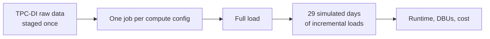

# elt-benchmark

**What the same ETL pipeline costs, and how long it takes, on each Databricks compute option, so you can pick compute from numbers instead of guesses.**

[YouTube channel](https://www.youtube.com/@FirstPrinciplesDE) · [Databricks bundle](databricks/) · [License](LICENSE)

> [!NOTE]
> Work in progress. Serverless results at scale factor 10 are in. Job cluster results are still to come. Every number below is a single run.



## Try it

You need a Databricks workspace, the [Databricks CLI](https://docs.databricks.com/aws/en/dev-tools/cli/install) logged in, and the [databricks-tpc-di](https://github.com/shannon-barrow/databricks-tpc-di) repo imported into your workspace. Run its data generator for the scale factor you want first. The bundle notes in [`databricks/`](databricks/README.md) have the steps.

```bash
cd databricks
databricks bundle deploy --var tpcdi_path=/Workspace/Users/<you>/databricks-tpc-di
databricks bundle run jc_2xlarge_sf10 --var tpcdi_path=/Workspace/Users/<you>/databricks-tpc-di
```

## What gets tested

Each compute config is one job. The job does a full load, then replays 29 days of small incremental files in order. Each day runs 17 tasks: file drops, 7 Auto Loader bronze loads, and the silver and gold merges. It is plain Spark, with no Spark Declarative Pipelines and no dbt. Only the compute changes.

Classic compute autoscales from 1 to 8 workers, and the driver uses the same node type as the workers.

| Group | Config | What changes |
|---|---|---|
| Serverless | `serverless_standard` | Standard performance |
| Serverless | `serverless_optimized` | Performance optimized |
| Job cluster | `jc_xlarge` | `m8gd.xlarge`, 4 vCPU |
| Job cluster | `jc_2xlarge` | `m8gd.2xlarge`, 8 vCPU |
| Job cluster | `jc_8xlarge` | `m8gd.8xlarge`, 32 vCPU |
| Experiment at 2xlarge | `jc_2xlarge_spot` | Workers on spot, with fallback to on-demand |
| Experiment at 2xlarge | `jc_2xlarge_nophoton` | Photon off |
| Experiment at 2xlarge | `jc_2xlarge_min2` | Workers autoscale 2 to 8 |

Planned next: serverless jobs with a size limit (Small, Medium, Large), an all-purpose cluster at 2xlarge, and a Large SQL warehouse.

Data is staged for scale factors 10, 1000 and 5000. SF10 runs first.

## Results

Scale factor 10, one run each.

| Config | Total | Full load | Average day | Fastest to slowest day |
|---|---|---|---|---|
| `serverless_standard` | 59.5 min | 362 s | 110 s | 93 to 134 s |
| `serverless_optimized` | 61.0 min | 96 s | 122 s | 110 to 137 s |

- Optimized wasn't faster than standard. The gap is within run-to-run noise.
- Each day loads about 0.9 MB, against about 240 MB for the first load. A day takes roughly 2 minutes, almost all of it task start-up and orchestration. Compute size probably won't move these numbers much at SF10, so the larger scale factors matter more for the comparison.
- The full load here is a clone of the staged historical tables from the TPC-DI repo's setup step, not a rebuild of history from raw files.

## Costs and limits

> [!WARNING]
> Running every job costs real money. The `8xlarge` cluster can scale to 9 nodes of 32 vCPU, about 288 vCPU in total. Check your cloud quota first. Classic runs fail with a quota error if the region's vCPU limit is too low, on-demand and spot are limited separately, and limits are per region.

- The benchmark runs on AWS with Graviton (`m8gd`) nodes and Databricks Runtime 17.3.
- Each run is one run. Repeats, medians and spread come later.

## What is next

- Job cluster results, then DBUs and cost per config.
- Setup notebooks for the data and the cost queries.
- Scale factors 1000 and 5000.

## Credit

The ETL workflow and data generator come from [shannon-barrow/databricks-tpc-di](https://github.com/shannon-barrow/databricks-tpc-di), a Databricks implementation of TPC-DI. This repo doesn't copy that code. It deploys the same workflow on different compute and measures the result. Thanks to Shannon Barrow for building it.

## Notes on TPC-DI

Results from this repo are derived from TPC-DI and are not official TPC-DI results. They are not comparable to published TPC-DI results.

## Layout

| Path | What it is |
|---|---|
| [`databricks/`](databricks/) | The Databricks bundle: one job per compute config and the script that generates them |

## License

[MIT](LICENSE)
