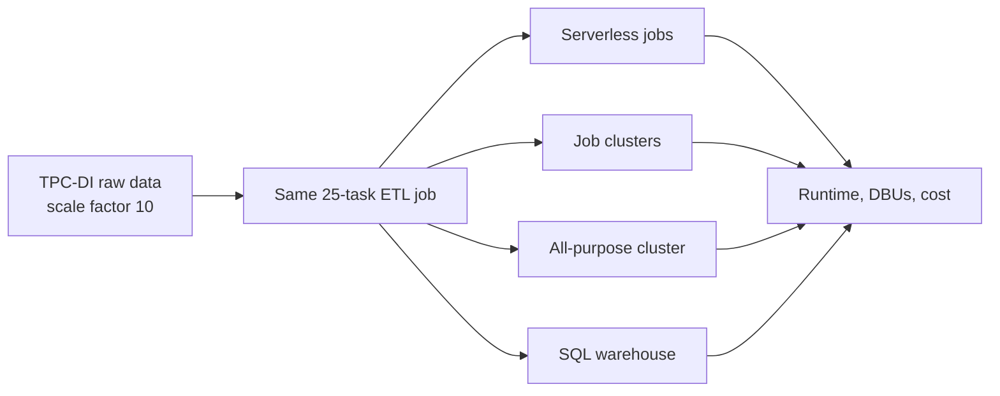

# elt-benchmark

**What the same ETL pipeline costs, and how long it takes, on each Databricks compute option, so you can pick compute from numbers instead of guesses.**

[YouTube channel](https://www.youtube.com/@FirstPrinciplesDE) · [Databricks bundle](databricks/) · [License](LICENSE)

> [!NOTE]
> No results yet. The jobs are built and deploy cleanly, but the benchmark runs haven't finished. This page lists what gets tested. Numbers are added once every run has finished.



## Try it

You need a Databricks workspace, the [Databricks CLI](https://docs.databricks.com/aws/en/dev-tools/cli/install) logged in, and the [databricks-tpc-di](https://github.com/shannon-barrow/databricks-tpc-di) repo imported into your workspace.

```bash
cd databricks
databricks bundle deploy --var tpcdi_path=/Workspace/Users/<you>/databricks-tpc-di
```

It creates 10 jobs, 1 SQL warehouse and 1 all-purpose cluster:

```text
Resources: 12 created, 0 changed, 0 deleted, 0 unchanged
```

The deploy starts the all-purpose cluster and the warehouse. Stop both when it finishes if you don't run the jobs right away.

## What gets tested

Every job runs the same 24 notebooks plus one cleanup check on TPC-DI scale factor 10 (about 1 GB of raw data). Only the compute changes. Workers autoscale from 1 to 8 on classic compute, and the driver uses the same node type as the workers.

| Group | Job | What changes |
|---|---|---|
| Serverless | `srv_standard` | Standard performance |
| Serverless | `srv_optimized` | Performance optimized |
| Job cluster | `jc_xlarge` | `m8gd.xlarge`, 4 vCPU |
| Job cluster | `jc_2xlarge` | `m8gd.2xlarge`, 8 vCPU |
| Job cluster | `jc_8xlarge` | `m8gd.8xlarge`, 32 vCPU |
| Experiment at 2xlarge | `jc_2xlarge_spot` | Workers on spot, with fallback to on-demand |
| Experiment at 2xlarge | `jc_2xlarge_nophoton` | Photon off |
| Experiment at 2xlarge | `jc_2xlarge_min2` | Workers autoscale 2 to 8 |
| Experiment at 2xlarge | `ap_2xlarge` | All-purpose cluster instead of a job cluster |
| Experiment at 2xlarge | `wh_large` | Serverless Pro SQL warehouse, Large |

Serverless jobs with a size limit (Small, Medium, Large) come next. They need compute objects created in the workspace first. See the [bundle notes](databricks/README.md).

## Costs and limits

> [!WARNING]
> Running every job costs real money. The `8xlarge` cluster can scale to 9 nodes of 32 vCPU, about 288 vCPU in total. Check your cloud quota first, and stop the warehouse and all-purpose cluster when you're done. Both are set to stop on their own after idle time.

- The benchmark runs on AWS with Graviton (`m8gd`) nodes and Databricks Runtime 17.3.
- The jobs read data that already exists in a Unity Catalog volume. Setup notebooks that create it are added after the first results.
- Each run is one run. Repeats, medians and spread come later.

## What is next

- Results table: runtime, DBUs and total cost per config.
- Setup notebooks for the data and the cost queries.
- More scale factors, then other clouds and engines, each in its own folder with the same method.

## Credit

The ETL workflow and data generator come from [shannon-barrow/databricks-tpc-di](https://github.com/shannon-barrow/databricks-tpc-di), a Databricks implementation of TPC-DI. This repo doesn't copy that code. It deploys the same workflow on different compute and measures the result. Thanks to Shannon Barrow for building it.

## Notes on TPC-DI

Results from this repo are derived from TPC-DI and are not official TPC-DI results. They are not comparable to published TPC-DI results.

## Layout

| Path | What it is |
|---|---|
| [`databricks/`](databricks/) | The Databricks bundle: jobs, warehouse, cluster and the script that generates them |

## License

[MIT](LICENSE)
